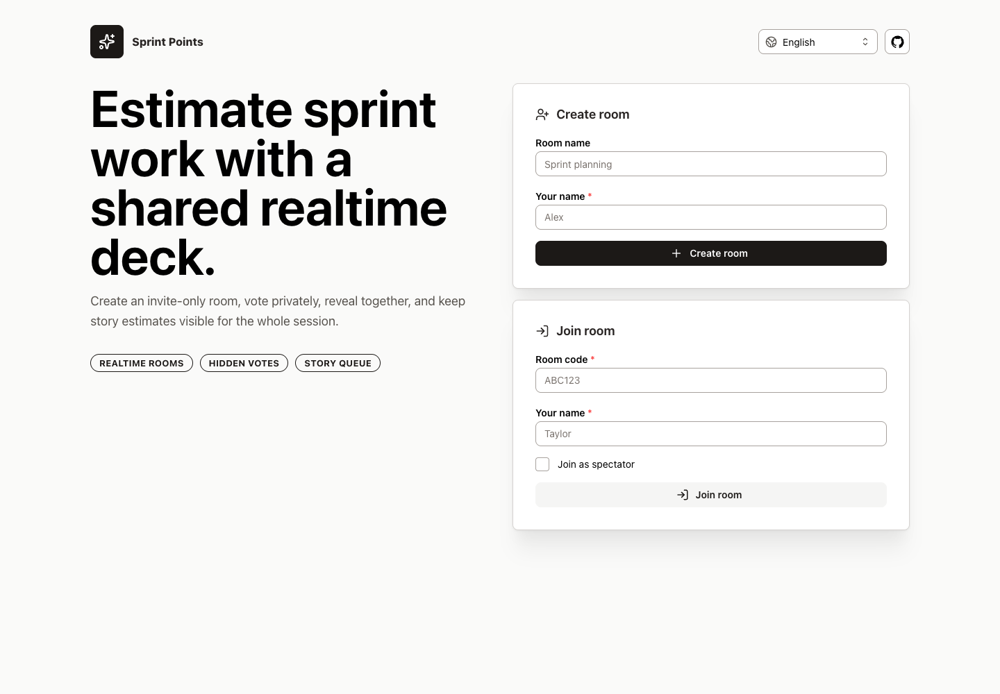
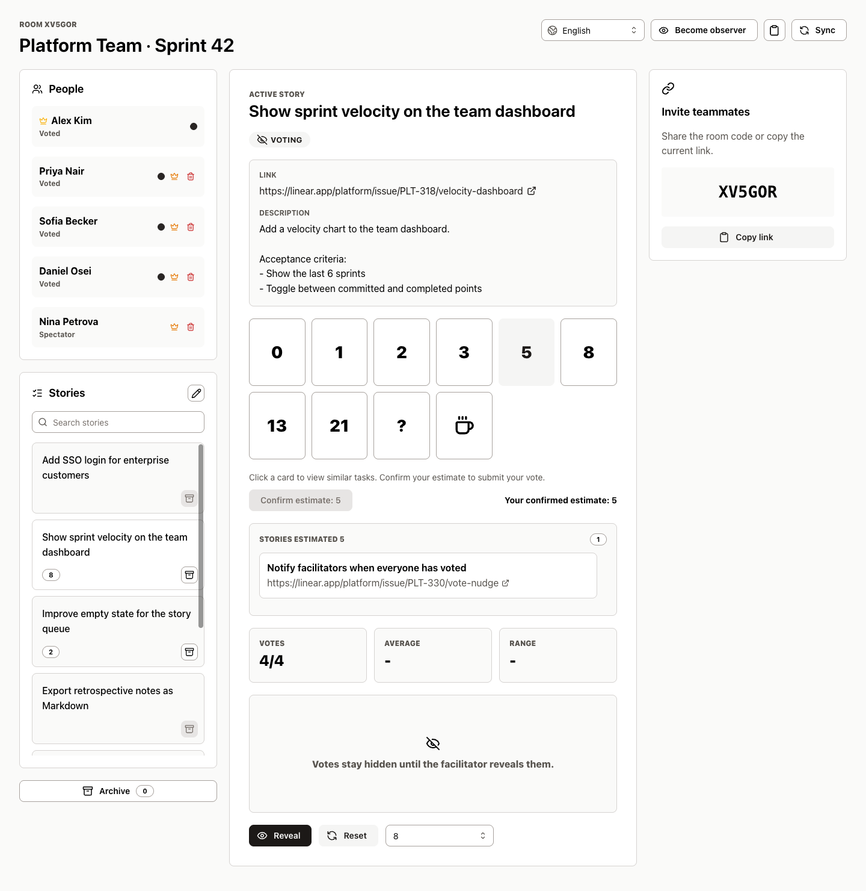
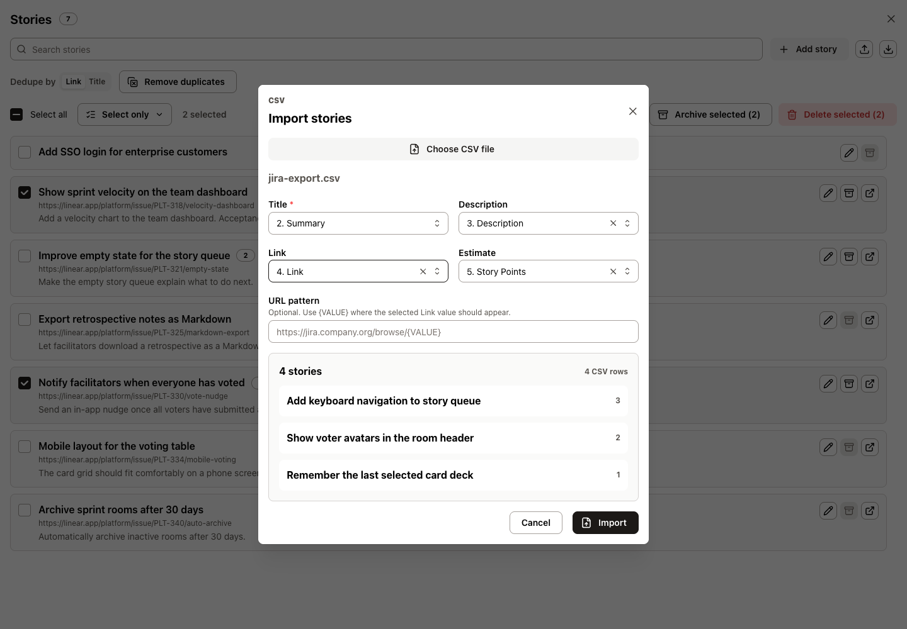

# Sprint Points

Sprint Points is a realtime planning poker app for agile teams. Create a room, invite teammates with a link, vote privately, reveal estimates together, and keep the story queue visible during refinement or sprint planning. Room changes are pushed to every participant over a WebSocket connection.

The backend is a TypeScript Worker built with Hono and Drizzle ORM. Drizzle owns the schema and applies migrations automatically inside the SQLite storage of one `RoomDatabase` Durable Object. That same object runs the API and keeps hibernatable WebSockets, so every request and room update stays serialized and local. The React/Vite frontend shares its TypeScript API types, request schemas, and constants with the Worker through `shared/`.

## Features

- **Realtime rooms** — participants, stories, votes, and estimates sync instantly over WebSocket.
- **Private voting** — everyone votes with a shared card deck; results stay hidden until the facilitator reveals them.
- **Session story queue** — a compact sidebar list for switching the active story, with quick search and one-click archiving.
- **Full-screen story management** — expand the queue into a focused workspace with add/edit, search, bulk selection, bulk archiving, and deletion.
- **Host bulk cleanup** — select all visible stories or only estimated/not estimated ones, then archive or delete them together.
- **Host duplicate detection** — choose whether duplicates are matched by link or by title, preview flagged copies, and remove extras in one action.
- **CSV import and export** — import Jira CSV exports with column mapping and export the current queue as CSV.
- **Participant controls** — spectator mode, host ownership transfer, and participant removal.
- **Bilingual interface** — English and Russian.

## Screenshots








## Tech Stack

- Frontend: React, TypeScript, Vite
- UI: Mantine, lucide-react icons
- Backend: TypeScript, Hono and Drizzle ORM on Cloudflare Workers
- Storage: SQLite inside a `RoomDatabase` Durable Object, with Drizzle migrations applied on startup
- Realtime: the same Durable Object uses the WebSocket Hibernation API
- API contract: OpenAPI 3.1 generated from Hono routes and Zod schemas
- Client: typed fetch SDK generated from the OpenAPI document with Hey API
- Tests: Vitest running inside the Workers runtime with real Durable Object storage
- Deployment: Cloudflare Workers, GitHub Pages for the frontend

## Requirements

- Node.js 24+ and npm 11+
- A Cloudflare account

## Architecture

```text
browser ──HTTP/WebSocket──▶ Worker (thin proxy)
                                  │
                                  ▼
                        Durable Object "RoomDatabase"
                          ├── Hono API + validation
                          ├── Drizzle ORM → SQLite + auto-migrations
                          └── hibernatable room sockets
```

- The Worker forwards every request to one Durable Object named `main`, so HTTP and WebSocket traffic share the same SQLite database and the same serialized execution.
- Hono handles routing, CORS, trailing-slash redirects, `{"detail": "..."}` errors, and WebSocket upgrades. Request bodies are validated with the same Zod schemas the frontend uses.
- `hono-openapi` turns the route definitions and Zod request/response schemas into an OpenAPI 3.1 document, served at `/api/openapi.json`. `backend/openapi.json` is generated by `npm run openapi:generate` and committed.
- `@hey-api/openapi-ts` generates the typed fetch client in `src/shared/api/generated` from that document. The frontend calls the generated SDK through `src/shared/api/client.ts`.
- Drizzle owns the schema in `backend/src/schema.ts`. `drizzle-kit` generates SQL migrations, and the Durable Object applies pending migrations before its first request.
- `RoomDatabase` accepts `/api/rooms/{id}/ws?participantToken=...&hostToken=...`, checks membership against SQLite, and keeps the socket hibernatable. After a mutation, the API calls the object's local broadcast callback, which sends `{"type":"room_updated"}` to that room's sockets.
- One Durable Object holds all rooms and sockets. That is plenty for planning-session traffic and keeps lookups, writes, and fanout consistent in one place.

## Deploy The Backend

```bash
npm install                 # frontend, shared and backend workspaces
cd backend
npx wrangler deploy
```

Set the admin secret after the first deploy:

```bash
cd backend && npx wrangler secret put ADMIN_TOKEN   # protects /api/admin/{export,import}
```

Pushes to `main` that touch `backend/`, `shared/`, or the root dependencies deploy
automatically through `.github/workflows/deploy-worker.yml` (typecheck, tests,
then `wrangler deploy`). It needs one repository secret:

| Secret | Meaning |
| --- | --- |
| `CLOUDFLARE_API_TOKEN` | Token with *Workers Scripts:Edit*, *Durable Objects:Edit*, and *Workers Routes:Edit*. |

The existing `RoomDatabase` Durable Object storage is reused, so an update
keeps the current rooms, participants, stories, and votes.

Attach `sprintpoints.<your-domain>` in **Workers & Pages → sprintpoints → Settings → Domains & Routes** (a Worker custom domain), or add a Worker route for a hostname that is already proxied by Cloudflare.

The Worker answers on `https://sprintpoints.<your-subdomain>.workers.dev/api/health` before any custom domain is attached.

## Deploy The Frontend

The frontend is built by `.github/workflows/deploy-pages.yml` and published to GitHub Pages. It reads two repository variables (Settings → Secrets and variables → Actions → Variables):

| Variable | Example | Meaning |
| --- | --- | --- |
| `VITE_API_URL` | `https://sprintpoints.example.com/api` | Backend base URL baked into the bundle at build time. |
| `VITE_BASE_PATH` | `/sprintpoints/` | Optional base path when the site is not served from the domain root. |

After changing a variable, re-run the *Deploy frontend to GitHub Pages* workflow.

## Environment Variables

Frontend (build time, `.env` locally or repository variables in CI):

| Name | Required | Description |
| --- | --- | --- |
| `VITE_API_URL` | No | Backend base URL. Defaults to `/api`, which relies on the Vite dev proxy. |
| `VITE_BASE_PATH` | No | Vite base path, for example `/sprintpoints/` on project pages. |

Backend (`backend/wrangler.jsonc` `vars`, plus secrets):

| Name | Required | Description |
| --- | --- | --- |
| `CORS_ORIGINS` | No | Comma-separated browser origins allowed to call the API, or `*`. Default `https://mishannn.github.io`. |
| `ADMIN_TOKEN` | Recommended | Secret protecting `/api/admin/export` and `/api/admin/import`. Without it both return 404. |
| `CLOUDFLARE_API_TOKEN` | For deploys | Account token used by the deploy workflow. Not stored in the repository. |

## Local Development

Install dependencies, regenerate the API client, and start Vite:

```bash
npm install
npm run openapi:generate   # OpenAPI spec + typed client
npm run dev
```

Run the Worker locally in another terminal:

```bash
npm run backend:dev          # wrangler dev, http://127.0.0.1:8787
```

The local Worker uses local Durable Object storage, so no Cloudflare login or
database is needed. Vite proxies `/api` to `http://127.0.0.1:8787` by default
(`vite.config.ts`); set `VITE_API_URL=http://127.0.0.1:8787/api` to call it
directly, and set `CORS_ORIGINS=*` if you want the dev server on another origin.

Local Worker secrets live in `backend/.dev.vars`:

```bash
ADMIN_TOKEN=local-development-token
```

## Tests

```bash
npm run backend:check                               # TypeScript
npm run backend:test                                # Vitest in the Workers runtime
npm run openapi:generate                            # Spec + typed client
node backend/scripts/smoke-test.mjs http://127.0.0.1:8787   # full API against a local Worker
node backend/scripts/ws-test.mjs http://127.0.0.1:8787      # WebSocket handshake and broadcast
```

The smoke and WebSocket scripts also accept a base URL, so they run against a deployed Worker.

## Existing Data

The `RoomDatabase` Durable Object keeps the same class name, migration tag,
tables and columns as the previous backend, and the initial Drizzle migration
uses `IF NOT EXISTS`. Deploying it over an existing Worker preserves rooms,
participants, stories and votes.

For an older PostgreSQL/NestJS dump, import it through the admin endpoint:

```bash
cd backend
ADMIN_TOKEN=... node scripts/import-dump.mjs \
  --url https://sprintpoints.example.com \
  --dump ../sprintpoints-dump.json \
  --verify
```

`postgres_export.sql` produces the dump shape from the old schema.

## API

`GET /api/health` returns `{"status":"ok"}` and `GET /api/openapi.json` returns the generated OpenAPI 3.1 document. Routes, headers, status codes, JSON field names, the `detail` error body, and the WebSocket message format are unchanged. See [backend/README.md](backend/README.md) for the full route list and the storage schema.

## Security Model

Room codes are invite links. Joining by code creates a participant token.

Room state and all room-scoped mutations require a token that belongs to that same room:

- A participant token can load that room, update that participant, heartbeat, vote as that participant, and subscribe to that room's WebSocket update stream (`/api/rooms/{room_id}/ws?participantToken=...`).
- A host token can load that room as host and run facilitator actions such as reveal, reset, story management, estimates, and participant removal.
- A participant token from one room cannot read issues from another room.
- Tokens are not exposed to other participants in room state.

This is an anonymous invite-link model, not account-based workspace authentication.

## Project Structure

```text
.
├── backend/
│   ├── src/
│   │   ├── app.ts          # Hono routes, validation, CORS and errors
│   │   ├── index.ts        # Worker entrypoint + RoomDatabase Durable Object
│   │   ├── schema.ts       # Drizzle tables and inferred row types
│   │   ├── lib.ts          # tokens, IDs, timestamps and room codes
│   │   └── env.ts          # Worker bindings
│   ├── drizzle/            # Generated SQL migrations and snapshots
│   ├── test/               # Vitest integration tests in the Workers runtime
│   ├── scripts/            # OpenAPI generator, smoke/WebSocket checks, dump importer
│   ├── openapi.json        # Generated OpenAPI 3.1 document
│   ├── drizzle.config.ts
│   ├── vitest.config.ts
│   └── wrangler.jsonc      # Worker and Durable Object bindings
├── shared/                 # TypeScript API types, Zod schemas and constants
├── src/                    # React frontend
│   └── shared/api/generated # Generated typed fetch SDK (Hey API)
├── openapi-ts.config.ts
├── .env.example
├── package.json
└── vite.config.ts
```

## License

MIT
