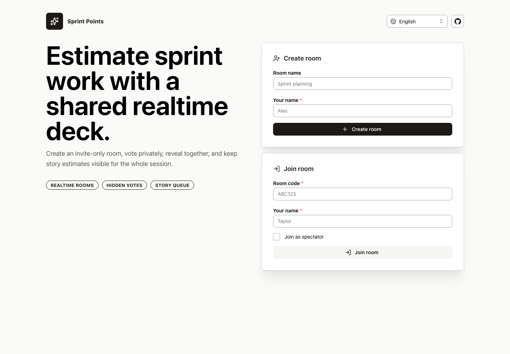
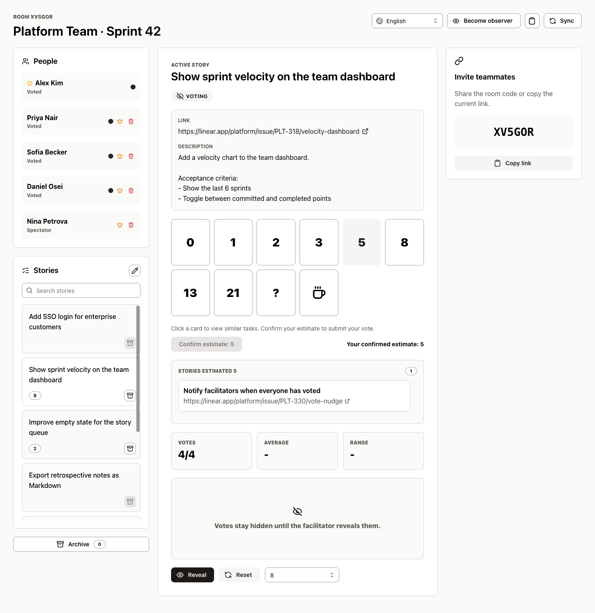
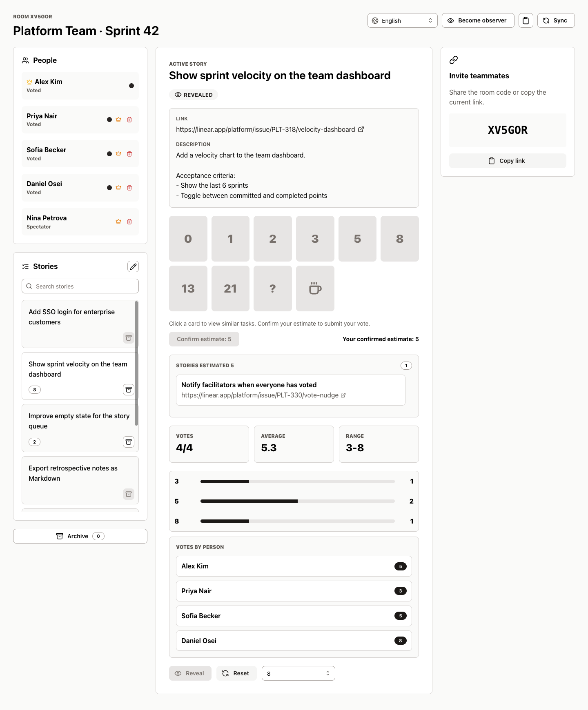
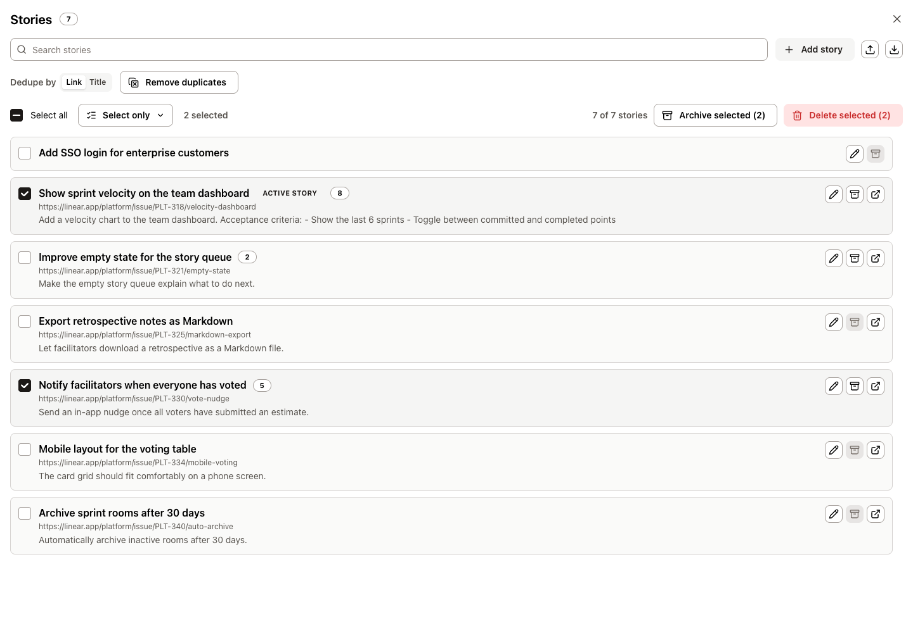
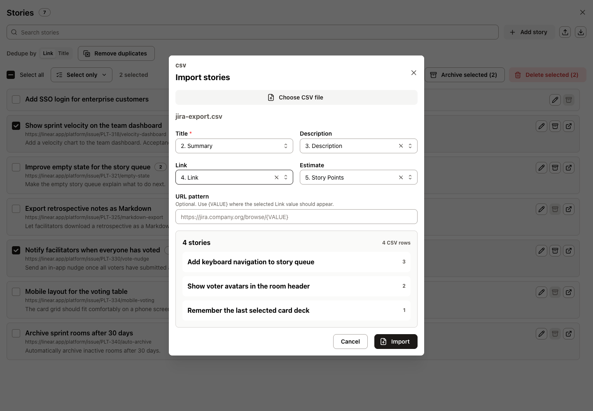

# Sprint Points

Sprint Points is a realtime planning poker app for agile teams. Create a room, invite teammates with a link, vote privately, reveal estimates together, and keep the story queue visible during refinement or sprint planning. Room changes are pushed to every participant over a WebSocket connection.

The app uses a React/Vite frontend and a NestJS backend backed by PostgreSQL in Docker Compose. The backend also supports SQLite for local development and tests.

## Features

- **Realtime rooms** — participants, stories, votes, and estimates sync instantly over WebSocket.
- **Private voting** — everyone votes with a shared card deck; results stay hidden until the facilitator reveals them.
- **Session story queue** — a compact sidebar list for switching the active story, with quick search and one-click archiving.
- **Full-screen story management** — expand the queue into a focused workspace with add/edit, search, bulk selection, bulk archiving, and deletion.
- **Host bulk cleanup** — select all visible stories or only estimated/not estimated ones, then archive or delete them together.
- **Host duplicate detection** — choose whether duplicates are matched by link or by title, preview flagged copies, and remove extras in one action. The best copy is kept: an estimated story first, then the active story, then the earliest one.
- **CSV import and export** — import Jira CSV exports with column mapping and export the current queue as CSV.
- **Participant controls** — spectator mode, host ownership transfer, and participant removal.
- **Bilingual interface** — English and Russian.

## Screenshots











## Tech Stack

- Frontend: React, TypeScript, Vite
- UI: Mantine, lucide-react icons
- Backend: NestJS 12, TypeORM, class-validator, ws, PostgreSQL/SQLite
- Deployment: Docker Compose, Caddy, GHCR

## Requirements

- Node.js 24+
- npm 11+
- Docker and Docker Compose for VPS deployment

## Production Start On A VPS

Create DNS `A` records for both application hostnames pointing at the VPS:

- `sprintpoints.<your-domain>`
- `admin.<your-domain>`

Then clone the repository, create `.env`, and start the stack from the project root:

```bash
cp .env.example .env
```

Edit `.env` and set:

- `BASE_DOMAIN`
- `POSTGRES_PASSWORD`
- `PGADMIN_DEFAULT_EMAIL`
- `PGADMIN_DEFAULT_PASSWORD`

Pull the published backend image and start the stack:

```bash
docker compose pull backend
docker compose up -d
```

If the GHCR package is private, authenticate Docker first:

```bash
echo "$GHCR_TOKEN" | docker login ghcr.io -u <github-user> --password-stdin
```

The backend image is:

```text
ghcr.io/mishannn/sprintpoints-backend:latest
```

Override `BACKEND_IMAGE` in `.env` to pin a release tag or digest. To build the
backend from source instead of pulling GHCR:

```bash
docker compose -f docker-compose.yml -f docker-compose.build.yml up -d --build
```

This starts:

- `caddy`: public HTTPS reverse proxy on ports `80` and `443`
- `db`: PostgreSQL 17 with a persistent Docker volume
- `backend`: NestJS API on internal port `8000`
- `db-admin`: pgAdmin behind `https://admin.<your-domain>`

Health check:

```bash
curl https://sprintpoints.<your-domain>/api/health
```

The backend creates the isolated `sprintpoints_nest` PostgreSQL schema and
applies TypeORM migrations before accepting requests. Existing tables without
the backend's own `nestjs_migrations` ledger are refused instead of adopted.

## Backend Image

CI publishes the backend image on pushes to `main` and on version tags:

- `ghcr.io/mishannn/sprintpoints-backend:latest`
- `ghcr.io/mishannn/sprintpoints-backend:sha-<commit>`
- `ghcr.io/mishannn/sprintpoints-backend:<git-tag>`

The workflow makes the GHCR package public when the repository token is
allowed to update package visibility. If it stays private, use `docker login
ghcr.io` as shown above.

## Upgrading From The Go Backend

The Go backend used the `sprintpoints` schema. NestJS uses
`sprintpoints_nest`. Existing installations can move their data once:

1. Stop the application backend and take a backup:

```bash
docker compose stop backend
docker compose exec -T db sh -c 'pg_dump -U "$POSTGRES_USER" -d "$POSTGRES_DB"' > backup-before-nestjs.sql
```

2. Create and migrate the NestJS schema without opening HTTP:

```bash
docker compose run --rm --no-deps -e DATABASE_SCHEMA=sprintpoints_nest \
  backend node dist/main.js -migrate
```

3. Run the transactional data import once:

```bash
docker compose exec -T db sh -c \
  'psql -v ON_ERROR_STOP=1 -U "$POSTGRES_USER" -d "$POSTGRES_DB" \
   -v source_schema=sprintpoints -v target_schema=sprintpoints_nest' \
  < ops/database/migrate-to-nestjs.sql
```

If the data is still in the older Python `public` schema, use
`-v source_schema=public`. The import refuses a nonempty target, invalid source
rows, and cross-room references. IDs, tokens, card sets and timestamps are
preserved; the source schema is untouched.

4. Start the backend:

```bash
docker compose up -d --remove-orphans backend
curl https://sprintpoints.<your-domain>/api/health
```

## Database Admin UI

Docker Compose includes pgAdmin with a preconfigured login and a preconfigured connection to the app database.

Open:

```text
https://admin.<your-domain>
```

Sign in with the credentials from `.env`:

| Field | Value |
| --- | --- |
| Email | `PGADMIN_DEFAULT_EMAIL` |
| Password | `PGADMIN_DEFAULT_PASSWORD` |

The server named `Planning Poker` is imported automatically from `docker/pgadmin/servers.json`. Its database passfile is generated from the Postgres environment variables when the pgAdmin container starts, so users should not need to configure the database connection manually.

pgAdmin stores its own UI metadata in the `pgadmin_data` Docker volume. The app data stays in the `postgres_data` volume.
Caddy stores ACME certificates in the `caddy_data` Docker volume and issues certificates automatically when the DNS records resolve to the VPS.

## Local Development

Install frontend dependencies:

```bash
npm install
```

Run the NestJS backend locally:

```bash
cd backend
npm install
DATABASE_URL=sqlite:///./sprintpoints-nest.sqlite3 npm run start:dev
```

In another terminal, start the frontend:

```bash
npm run dev
```

Open:

```text
http://localhost:5173/
```

Vite proxies `/api` to `http://127.0.0.1:8000` during development.

## Environment Variables

| Name | Required | Description |
| --- | --- | --- |
| `VITE_API_URL` | No | Frontend API base URL. Defaults to `/api`. |
| `VITE_BASE_PATH` | No | Override Vite base path, useful for custom domains. |
| `DATABASE_URL` | No | PostgreSQL (`postgres://` / `postgresql://`) or SQLite (`sqlite:///`) URL. Compose configures PostgreSQL from `POSTGRES_*`. Defaults to `sqlite:///./sprintpoints-nest.sqlite3`. |
| `DATABASE_SCHEMA` | No | PostgreSQL schema created and migrated by the backend; default `sprintpoints_nest`. A single URL `search_path` takes precedence. |
| `NEST_DATABASE_SCHEMA` | No | Compose value passed to the backend's `DATABASE_SCHEMA`; default `sprintpoints_nest`. |
| `BACKEND_IMAGE` | No | Backend image; default `ghcr.io/mishannn/sprintpoints-backend:latest`. |
| `LISTEN_ADDR` | No | HTTP listen address, default `:8000`. |
| `PLANNING_POKER_CORS_ORIGINS` | No | Comma-separated allowed browser origins. Defaults to `*`. |
| `BASE_DOMAIN` | Yes for Compose | Base domain used by Caddy. `sprintpoints` and `admin` subdomains are created from it. |
| `POSTGRES_DB` | Yes for Compose | PostgreSQL database name. |
| `POSTGRES_USER` | Yes for Compose | PostgreSQL username. |
| `POSTGRES_PASSWORD` | Yes for Compose | PostgreSQL password. |
| `PGADMIN_DEFAULT_EMAIL` | Yes for Compose | pgAdmin login email. |
| `PGADMIN_DEFAULT_PASSWORD` | Yes for Compose | pgAdmin login password. |

## Backend

The NestJS backend lives in [backend](backend/README.md). Controllers stay thin,
services own transactions, and persistence uses TypeORM entities. Its API keeps
the existing routes, headers, status codes, JSON fields, error body and
WebSocket event.

Main tables:

- `rooms`: room metadata, card set, reveal state, active story, host token
- `participants`: room members, spectator flag, heartbeat timestamp, participant token
- `issues`: story queue, descriptions, links, order, final estimates, archive timestamps
- `votes`: one vote per participant per story

## Security Model

Room codes are invite links. Joining by code creates a participant token.

Room state and all room-scoped mutations require a token that belongs to that same room:

- A participant token can load that room, update that participant, heartbeat, vote as that participant, and subscribe to that room's WebSocket update stream (`/api/rooms/{room_id}/ws`, token passed as a query parameter).
- A host token can load that room as host and run facilitator actions such as reveal, reset, story management, estimates, and participant removal.
- A participant token from one room cannot read issues from another room.
- Tokens are not exposed to other participants in room state.

This is an anonymous invite-link model, not account-based workspace authentication.

## Development Commands

```bash
cd backend
npm test
npm run test:postgres
npm run build
```

Runs the backend API/WebSocket tests against temporary SQLite databases, the
PostgreSQL integration suite when `TEST_POSTGRES_URL` is set, and builds the
production server. CI runs both suites with Node 24 and a PostgreSQL 17 service.

```bash
npm run dev
```

Runs the local frontend development server.

```bash
npm run build
```

Type-checks and builds the production frontend into `dist`.

```bash
npm run preview
```

Serves the production frontend build locally.

## Project Structure

```text
.
├── docker-compose.yml
├── docker-compose.build.yml
├── backend/
│   ├── Dockerfile
│   ├── README.md           # Backend architecture and API contract
│   ├── src/
│   │   ├── common/         # DTOs, errors, validation, CORS
│   │   ├── database/       # TypeORM entities, migrations, transactions
│   │   ├── realtime/       # Process-local WebSocket room hub
│   │   ├── rooms/          # Feature modules and controllers
│   │   ├── participants/
│   │   ├── issues/
│   │   └── votes/
│   └── test/               # API, WebSocket, persistence and migration tests
├── ops/database/           # Legacy Go -> NestJS data transfer SQL
├── src/
│   ├── app/
│   ├── entities/
│   ├── features/
│   ├── pages/
│   ├── shared/
│   └── widgets/
├── .env.example
├── package.json
└── vite.config.ts
```

## License

MIT
