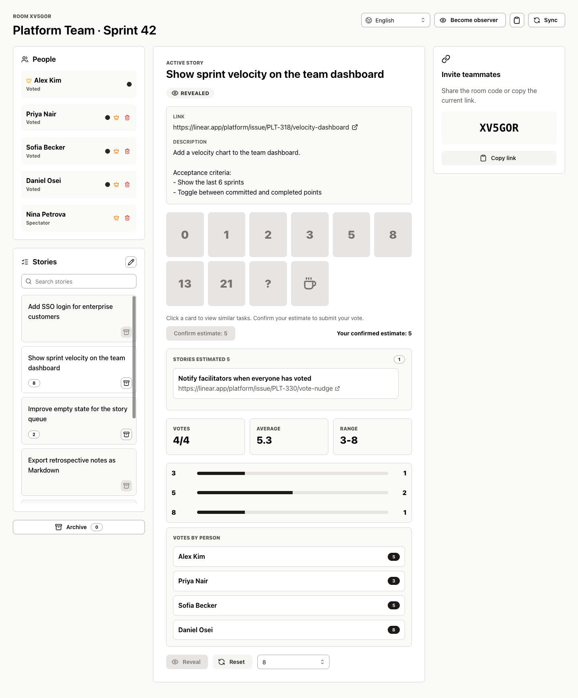
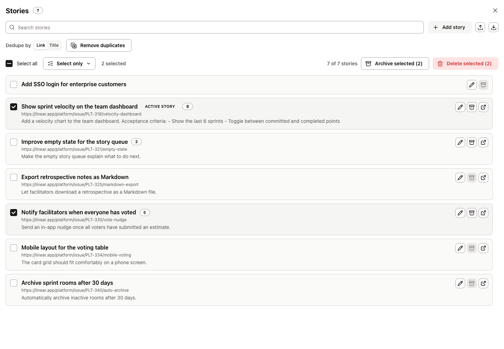

# Sprint Points

Sprint Points is a realtime planning poker app for agile teams. Create a room, invite teammates with a link, vote privately, reveal estimates together, and keep the story queue visible during refinement or sprint planning. Room changes are pushed to every participant over a WebSocket connection.

The backend is FastAPI on Cloudflare Python Workers. SQLAlchemy ORM stores rooms, participants, stories, and votes in D1. A small Durable Object keeps hibernatable WebSockets and fans out `room_updated` events. The React/Vite frontend keeps its TypeScript API types in `shared/`; the Python models mirror the same JSON contract.

## Features

- **Realtime rooms** — participants, stories, votes, and estimates sync instantly over WebSocket.
- **Private voting** — everyone votes with a shared card deck; results stay hidden until the facilitator reveals them.
- **Session story queue** — a compact sidebar list for switching the active story, with quick search and one-click archiving.
- **Full-screen story management** — expand the queue into a focused workspace with add/edit, search, bulk selection, bulk archiving, and deletion.
- **Host bulk cleanup** — select all visible stories or only estimated/not estimated ones, then archive or delete them together.
- **Host duplicate detection** — choose whether duplicates are matched by link or by title, preview flagged copies, and remove extras in one action.
- **CSV import and export** — import Jira CSV exports with column mapping and export the current queue as CSV.
- **Participant controls** — spectator mode, host ownership transfer, and participant removal.
- **Bilingual interface** — English and Russian.

## Screenshots







## Tech Stack

- Frontend: React, TypeScript, Vite
- UI: Mantine, lucide-react icons
- Backend: FastAPI, Pydantic and SQLAlchemy on Cloudflare Python Workers
- Storage: Cloudflare D1 through the `sqlalchemy-cloudflare-d1` dialect
- Realtime: one `RoomHub` Durable Object using the WebSocket Hibernation API
- Deployment: Cloudflare Workers, GitHub Pages for the frontend

## Requirements

- Node.js 24+ and npm 11+
- Python 3.13+ and [uv](https://docs.astral.sh/uv/) 0.13.4+
- A Cloudflare account

## Architecture

```text
browser ──HTTP──▶ Python Worker (FastAPI, Pydantic, SQLAlchemy ORM)
   │                    │
   │                    └──▶ D1: rooms, participants, issues, votes
   │
   └──WebSocket────────▶ RoomHub Durable Object
                            hibernatable sockets, tagged by room
                            ▲
                            └── each mutation calls /broadcast/{room_id}
```

- FastAPI validates request bodies with Pydantic and returns the same status codes, field names, and `{"detail": "..."}` error bodies as before.
- SQLAlchemy models own the D1 schema; missing tables are created on the first request in an isolate. The D1 database is bound as `DB`.
- `RoomHub` accepts `/api/rooms/{id}/ws?participantToken=...&hostToken=...`, checks membership against D1, and keeps the socket hibernatable. Mutations call the same object through the `ROOMS` binding, and it sends `{"type":"room_updated"}` to that room's sockets.
- One Durable Object holds all WebSocket connections. Room data itself lives in D1, so the WebSocket object stays small and can hibernate while idle.

D1 auto-commits each statement. Unlike the previous SQLite-backed Durable Object, a handler that writes several rows (for example create-room) is not one transaction. The app is designed for the small, low-write traffic of a planning session; if you need strict multi-row atomicity, move those handlers behind a Durable Object or use a D1 batch.

## Deploy The Backend

Create the D1 database once:

```bash
cd backend
npx wrangler d1 create sprintpoints
```

Copy the returned `database_id` into `backend/wrangler.jsonc` in place of
`REPLACE_WITH_D1_DATABASE_ID`, or provide it as the `D1_DATABASE_ID` GitHub
secret (the deploy workflow substitutes it).

Then deploy:

```bash
npm install                 # frontend and shared workspace
cd backend
uv sync --group dev
uv run pywrangler deploy
```

Set the admin secret after the first deploy:

```bash
cd backend && npx wrangler secret put ADMIN_TOKEN   # protects /api/admin/{export,import}
```

Pushes to `main` that touch `backend/` deploy automatically through
`.github/workflows/deploy-worker.yml` (lint, tests, then `pywrangler deploy`).
It needs two repository secrets:

| Secret | Meaning |
| --- | --- |
| `CLOUDFLARE_API_TOKEN` | Token with *Workers Scripts:Edit*, *D1:Edit*, *Durable Objects:Edit*, and *Workers Routes:Edit*. |
| `D1_DATABASE_ID` | ID of the `sprintpoints` D1 database. |

Attach `sprintpoints.<your-domain>` in **Workers & Pages → sprintpoints → Settings → Domains & Routes** (a Worker custom domain), or add a Worker route for a hostname that is already proxied by Cloudflare.

The Worker answers on `https://sprintpoints.<your-subdomain>.workers.dev/api/health` before any custom domain is attached.

## Deploy The Frontend

The frontend is built by `.github/workflows/deploy-pages.yml` and published to GitHub Pages. It reads two repository variables (Settings → Secrets and variables → Actions → Variables):

| Variable | Example | Meaning |
| --- | --- | --- |
| `VITE_API_URL` | `https://sprintpoints.example.com/api` | Backend base URL baked into the bundle at build time. |
| `VITE_BASE_PATH` | `/sprintpoints/` | Optional base path when the site is not served from the domain root. |

After changing a variable, re-run the *Deploy frontend to GitHub Pages* workflow.

## Environment Variables

Frontend (build time, `.env` locally or repository variables in CI):

| Name | Required | Description |
| --- | --- | --- |
| `VITE_API_URL` | No | Backend base URL. Defaults to `/api`, which relies on the Vite dev proxy. |
| `VITE_BASE_PATH` | No | Vite base path, for example `/sprintpoints/` on project pages. |

Backend (`backend/wrangler.jsonc` `vars`, plus secrets):

| Name | Required | Description |
| --- | --- | --- |
| `CORS_ORIGINS` | No | Comma-separated browser origins allowed to call the API, or `*`. Default `https://mishannn.github.io`. |
| `ADMIN_TOKEN` | Recommended | Secret protecting `/api/admin/export` and `/api/admin/import`. Without it both return 404. |
| `CLOUDFLARE_API_TOKEN` | For deploys | Account token used by the deploy workflow. Not stored in the repository. |
| `D1_DATABASE_ID` | For deploys | D1 database ID substituted into `wrangler.jsonc` in CI. |

## Local Development

Install frontend dependencies and start Vite:

```bash
npm install
npm run dev
```

Run the Python Worker locally in another terminal:

```bash
npm run backend:dev          # uv run pywrangler dev, http://127.0.0.1:8787
```

The local Worker uses a local D1 database, so no Cloudflare login or database
is needed. Vite proxies `/api` to `http://127.0.0.1:8787` by default
(`vite.config.ts`); set `VITE_API_URL=http://127.0.0.1:8787/api` to call it
directly, and set `CORS_ORIGINS=*` if you want the dev server on another origin.

Local Worker secrets live in `backend/.dev.vars`:

```bash
ADMIN_TOKEN=local-development-token
```

## Tests

```bash
cd backend
uv run ruff check .
uv run pytest                       # FastAPI routes against in-memory SQLite
node scripts/smoke-test.mjs http://127.0.0.1:8787   # full API against a local Worker
node scripts/ws-test.mjs http://127.0.0.1:8787      # WebSocket handshake and broadcast
```

The smoke and WebSocket scripts also accept a base URL, so they run against a deployed Worker.

## Moving Existing Data

The previous backend stored everything inside a Durable Object. Export it
before deploying this version, then import the dump into D1:

```bash
# 1. While the old Worker is still live:
curl -H "X-Admin-Token: $ADMIN_TOKEN" \
  https://sprintpoints.example.com/api/admin/export > sprintpoints-dump.json

# 2. After the new Worker and D1 database are deployed:
cd backend
ADMIN_TOKEN=... node scripts/import-dump.mjs \
  --url https://sprintpoints.example.com \
  --dump ../sprintpoints-dump.json \
  --verify
```

`postgres_export.sql` still produces the same dump shape from the older
PostgreSQL/NestJS schema.

## API

`GET /api/health` returns `{"status":"ok"}`. Routes, headers, status codes, JSON field names, the `detail` error body, and the WebSocket message format are unchanged. See [backend/README.md](backend/README.md) for the full route list and the storage schema.

## Security Model

Room codes are invite links. Joining by code creates a participant token.

Room state and all room-scoped mutations require a token that belongs to that same room:

- A participant token can load that room, update that participant, heartbeat, vote as that participant, and subscribe to that room's WebSocket update stream (`/api/rooms/{room_id}/ws?participantToken=...`).
- A host token can load that room as host and run facilitator actions such as reveal, reset, story management, estimates, and participant removal.
- A participant token from one room cannot read issues from another room.
- Tokens are not exposed to other participants in room state.

This is an anonymous invite-link model, not account-based workspace authentication.

## Project Structure

```text
.
├── backend/
│   ├── src/
│   │   ├── app.py          # FastAPI app, middleware and error handlers
│   │   ├── worker.py       # Workers entrypoint + RoomHub Durable Object
│   │   ├── models.py       # SQLAlchemy models
│   │   ├── db.py           # D1 engine, schema bootstrap and session dependency
│   │   ├── schemas.py      # Pydantic request bodies
│   │   ├── security.py     # token checks and access rules
│   │   ├── views.py        # row-to-JSON shaping
│   │   ├── clock.py        # UTC timestamps
│   │   ├── identity.py     # IDs, tokens and room codes
│   │   ├── events.py       # WebSocket broadcast helper
│   │   ├── config.py       # constants and Worker settings
│   │   └── routes/         # rooms, participants, issues, votes, admin
│   ├── tests/              # FastAPI tests against in-memory SQLite
│   ├── scripts/            # Smoke/WebSocket tests and the dump importer
│   ├── pyproject.toml      # Python dependencies and tooling
│   └── wrangler.jsonc      # Worker, D1 and Durable Object bindings
├── shared/                 # TypeScript API types and constants for the frontend
├── src/                    # React frontend
├── .env.example
├── package.json
└── vite.config.ts
```

## License

MIT
